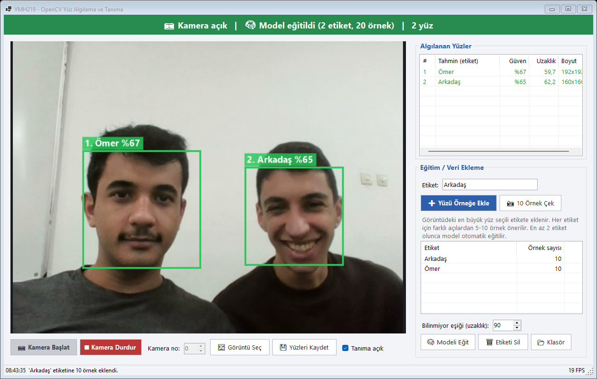
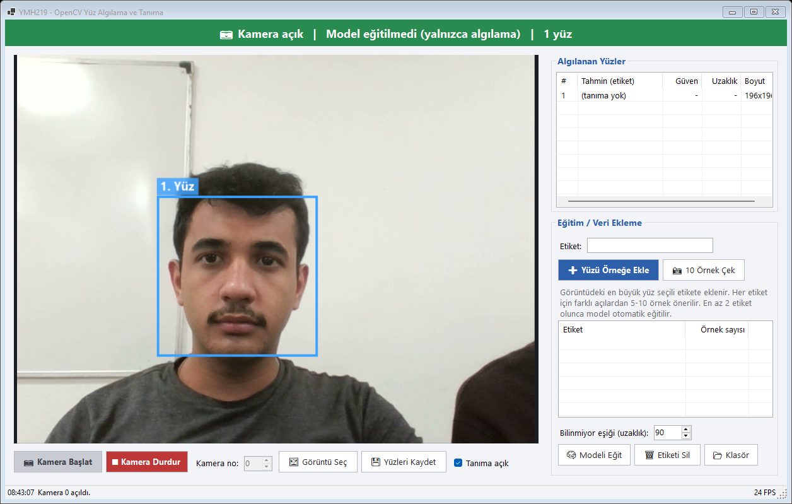
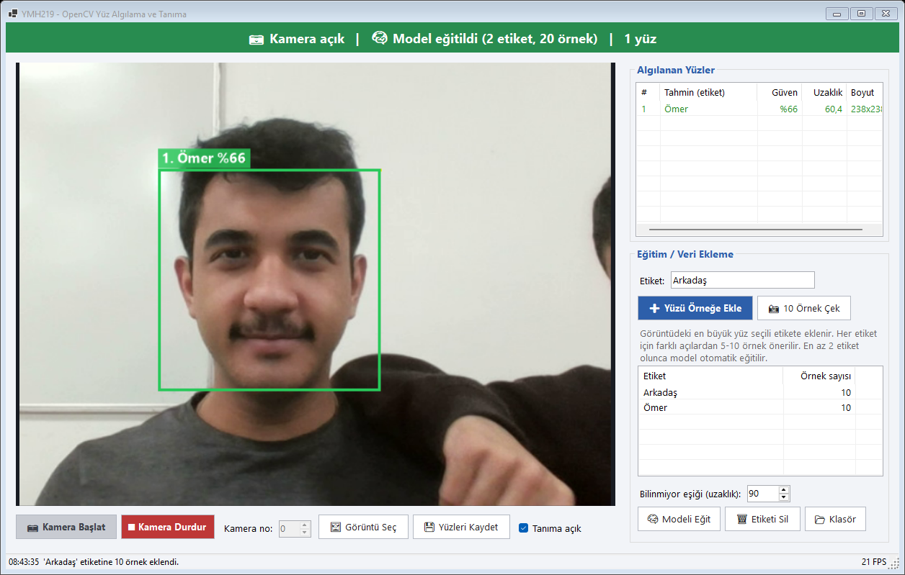

# YMH219 - OpenCV ile Yüz Algılama ve Tanıma

Nesne Tabanlı Programlama (YMH 219) dersi ek uygulama ödevi kapsamında **C# / .NET Windows Forms** ve **OpenCvSharp** ile geliştirilmiş masaüstü uygulaması.
Kameradan veya dosyadan alınan görüntüde yüzleri **Haar Cascade** ile algılar ve dikdörtgenle işaretler. Kullanıcının oluşturduğu küçük yerel veri seti ile **LBPH** algoritmasını eğitir; her yüz için tahmin edilen etiketi ve güven skorunu gösterir.

## Ekran Görüntüleri

**İki kişinin aynı karede tanınması (2 etiket, 20 örnekle eğitilmiş model)**


| Model eğitilmeden: yalnızca algılama | Tek kişi tanıma |
|:---:|:---:|
|  |  |

> Ekran görüntülerindeki yüzler öğrencinin kendisine ve izin veren bir arkadaşına aittir. Görüntüler uygulamanın kendi kamera akışından alınmıştır.

## Kullanılan Teknolojiler / NuGet Paketleri

- C# 14 / .NET 10 (`net10.0-windows`), Windows Forms
- **OpenCvSharp4** `4.13.0.20261107`: OpenCV'nin .NET sarmalayıcısı (`CascadeClassifier`, `VideoCapture`, `Mat`, `Cv2`)
- **OpenCvSharp4.runtime.win**: Windows için yerel OpenCV kütüphanesi (contrib `face` modülü dahil, `LBPHFaceRecognizer`)
- **OpenCvSharp4.Extensions**: `Mat` → `Bitmap` dönüşümü (`BitmapConverter`)
- Yüz algılama modeli: OpenCV'nin resmi `haarcascade_frontalface_default.xml` dosyası (`FaceRecognition/Assets/`)

## Kurulum ve Çalıştırma

**Visual Studio ile:**
1. Depoyu klonlayın: `git clone https://github.com/Omerdoganse/YMH219-FaceRecognition.git`
2. `YMH219-FaceRecognition.sln` dosyasını Visual Studio 2022 (17.14+) / 2026 ile açın. NuGet paketleri otomatik geri yüklenir.
3. Platformun **x64** (Any CPU, 64 bit) olduğundan emin olup `F5` ile çalıştırın.

**Komut satırı ile:**
```bash
cd YMH219-FaceRecognition
dotnet run --project FaceRecognition
```

> .NET 10 SDK ve 64 bit Windows gereklidir. Kamera için Windows'ta **Ayarlar → Gizlilik ve güvenlik → Kamera** bölümünde masaüstü uygulamalarına izin verilmelidir.

## Kullanım

1. **📷 Kamera Başlat** ile kamerayı açın (birden fazla kamera varsa *Kamera no* değiştirilebilir) veya **🖼 Görüntü Seç** ile bir fotoğraf açın. Bulunan yüzler mavi dikdörtgenle işaretlenir.
2. **Etiket** kutusuna kişinin adını yazın (örn. *Ömer*). **📸 10 Örnek Çek** kameradan aralıklarla 10 yüz örneği alır, **➕ Yüzü Örneğe Ekle** yalnızca o anki kareyi ekler. Örnek çekerken başınızı hafifçe sağa sola çevirin.
3. İkinci kişi (veya aynı kişinin farklı görünümü) için 2. adımı başka bir etiketle tekrarlayın.
4. En az **2 etiket** olduğunda model otomatik eğitilir (**🧠 Modeli Eğit** ile elle de eğitilebilir). Artık yüzlerin üstünde **etiket ve güven skoru** görünür:
   - 🟩 yeşil: tanınan kişi
   - 🟧 turuncu: *Bilinmiyor* (uzaklık eşiğin üstünde)
   - 🟦 mavi: yalnızca algılama (model eğitilmemiş veya *Tanıma açık* kapalı)
5. **Bilinmiyor eşiği** ile tanımanın ne kadar katı olacağı ayarlanır (küçük değer = daha katı).
6. **💾 Yüzleri Kaydet** ekrandaki tüm yüzleri ayrı PNG dosyaları olarak kaydeder. **🗑 Etiketi Sil** bir kişiyi veri setinden kaldırır, **📂 Klasör** veri seti klasörünü açar.

Veri seti `%LOCALAPPDATA%\YMH219-FaceRecognition\FaceData\<etiket>\*.png` konumunda tutulur. Kişisel veri olduğu için depoya **eklenmez** (`.gitignore`).

## Temel Özellikler

- Kamera görüntüsü (~20 FPS) veya seçilen resim `PictureBox` içinde gösterilir.
- Haar Cascade ile **yüz algılama** ve dikdörtgenle işaretleme. **Aynı karede birden fazla yüz** desteklenir.
- LBPH ile **tanıma**: etiket, güven skoru (%) ve LBPH uzaklığı yüzün üstünde ve **Algılanan Yüzler** listesinde gösterilir.
- **Basit eğitim / veri ekleme ekranı:** etiket oluşturma, tekli ve 10'lu örnek çekimi, etiket ve örnek sayısı listesi, etiket silme.
- Kamera **Başlat / Durdur**, **Görüntü Seç**, algılanan yüzleri **ayrı klasöre kaydetme**.
- Üst şeritte kamera ve model durumu, alt çubukta son işlem ve FPS gösterilir.
- **Hata kontrolleri** (uygulama kapanmaz, anlaşılır mesaj gösterilir):
  - Model dosyası yok veya bozuk → *"Yüz algılama modeli bulunamadı..."*
  - Kamera açılamıyor, başka uygulama kullanıyor veya izin yok → *"Kamera 0 açılamadı..."*
  - Kamera bağlantısı koptu → *"Kameradan görüntü alınamıyor..."*
  - Geçersiz görüntü dosyası, görüntüde yüz yok, tek etiketle eğitim denemesi, geçersiz etiket adı, dosya yazma hataları

## Proje Yapısı ve Sınıf Tasarımı

```
FaceRecognition/
├── Program.cs
├── MainForm.cs                  # Arayüz, olay yönetimi, kamera karelerini ekrana aktarma
├── FaceOverlayRenderer.cs       # Dikdörtgen + etiket çizimi (GDI+, Türkçe karakter desteği)
├── Assets/
│   └── haarcascade_frontalface_default.xml
├── Models/
│   ├── FaceResult.cs            # Bir yüzün konumu, etiketi, uzaklığı, güven skoru
│   └── LabelInfo.cs             # Etiket adı + örnek sayısı (record)
└── Services/
    ├── FaceDetector.cs          # CascadeClassifier sarmalayıcısı, yüz bölgesini hazırlama
    ├── FaceRecognizerService.cs # LBPHFaceRecognizer: eğitim, tahmin, bilinmeyen eşiği
    ├── FrameProcessor.cs        # Algılama + tanımayı birleştiren işlem hattı
    ├── FaceDataStore.cs         # Etiketli yüz örneklerini diskte saklama / yükleme / silme
    ├── CameraService.cs         # VideoCapture ile arka planda kare okuma (Task + CancellationToken)
    └── FaceAppException.cs      # Kullanıcıya gösterilecek anlaşılır hata türü
```

- **Sorumlulukların ayrılması:** Algılama, tanıma, veri saklama ve kamera ayrı sınıflardadır. `FrameProcessor` bu servisleri birleştirir (kompozisyon), form ise yalnızca servisleri kullanır.
- **Kapsülleme:** OpenCV nesneleri (`CascadeClassifier`, `LBPHFaceRecognizer`, `VideoCapture`) servislerin içinde `private` tutulur. Dışarıya `IsTrained`, `IsRunning`, `LabelCount` gibi salt okunur özellikler açılır.
- **Olaylar (event):** `CameraService.FrameCaptured` ve `CameraError` olayları arka plan iş parçacığından gelir. Form, arayüzü `BeginInvoke` ile günceller ve arayüz yetişemezse kare atlar.
- **Kaynak yönetimi:** `Mat` gibi yerel bellek kullanan nesneler `using` / `Dispose` ile serbest bırakılır. Servisler `IDisposable` arayüzünü uygular ve form kapanırken kamera ve model temizlenir. Kamera iş parçacığı ile arayüz arasındaki ortak veriler `lock` ile korunur.
- **Kalıtım:** `FaceAppException`, `Exception` sınıfından türer.

### Tanıma nasıl çalışıyor?
1. Yüz bölgesi kesilir, griye çevrilir, 120x120 boyutuna getirilir ve histogram eşitlenir.
2. LBPH her yüzü küçük bölgelere ayırıp yerel ikili desen histogramları çıkarır.
3. Yeni yüzün histogramı eğitim örnekleriyle karşılaştırılır. En yakın örneğin etiketi ve **uzaklığı** döner.
4. Uzaklık eşiğin (varsayılan 90) üstündeyse sonuç *Bilinmiyor* olur. Güven skoru uzaklıktan hesaplanan yaklaşık bir yüzdedir: `100 - uzaklık / (2 x eşik) x 100`.

## Bilinen Sınırlamalar / Geliştirme Notları

- Haar Cascade yalnızca **önden bakan** yüzleri iyi bulur. Profil, çok eğik baş veya karanlık ortamda yüz kaçabilir.
- LBPH, derin öğrenme yöntemlerine göre basittir. Işık ve açı değişimine duyarlıdır ve az örnekle güven skorları %60-70 civarındadır. Örnek sayısı arttıkça ve örnekler farklı açılardan çekildikçe sonuç iyileşir.
- Güven skoru olasılık değil, LBPH uzaklığından türetilmiş yaklaşık bir değerdir.
- Yerel OpenCV kütüphanesi yalnızca **Windows x64** için eklenmiştir.
- **Etik / kapsam:** Uygulama yalnızca ders kapsamında, yerel ve gönüllü örneklerle kullanılmak içindir. Veriler hiçbir yere gönderilmez. Kamuya açık alanlarda izinsiz kimlik takibi veya gizli görüntü toplama amacıyla kullanılmamalıdır.

## Öğrenci Bilgileri

- **Ad Soyad:** Ömer Doğan
- **Öğrenci No:** 250541101
- **Ders:** Nesne Tabanlı Programlama (YMH 219)
